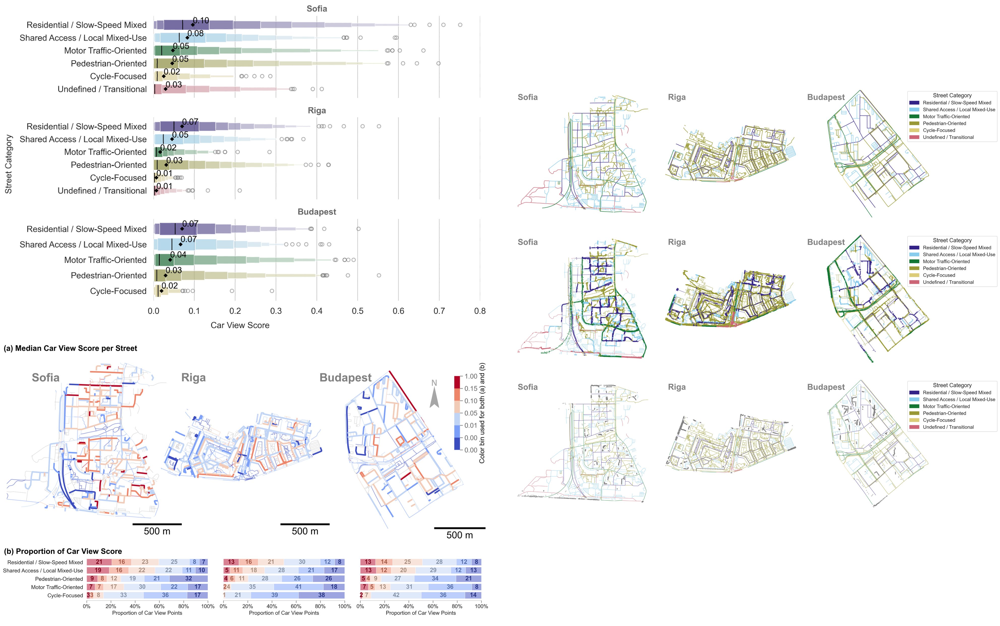

# streets-estates-car-dominance-svi
Code for "Streets in Large Housing Estates" paper

This repository contains the code and visual outputs used to generate figures for the journal article:  
**_Car dominance as a challenge for neighbourhoods: A mixed-method assessment of public open space in large housing estates_**

Below is a combined image containing all figures produced by the notebook `car_dominance_svi_analysis_and_figures.ipynb`, used in the article:

> [!NOTE]
> Visual indices were provided by [Winston Yap](https://github.com/winstonyym) (NUS)  
> Street View data sourced via [Mapillary](https://www.mapillary.com/) 